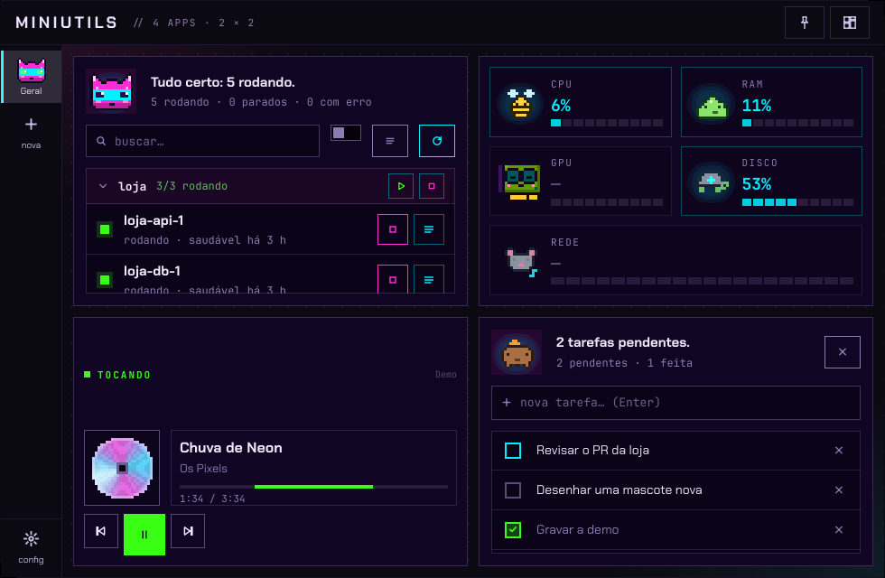
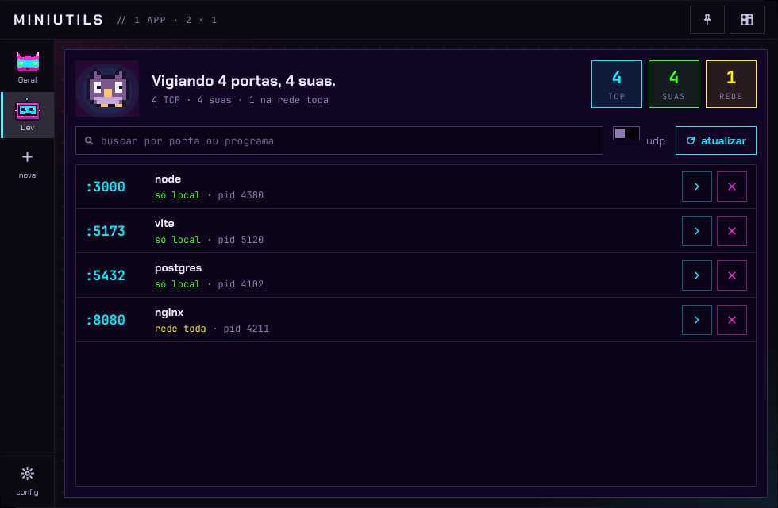
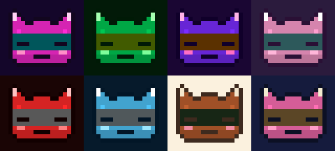
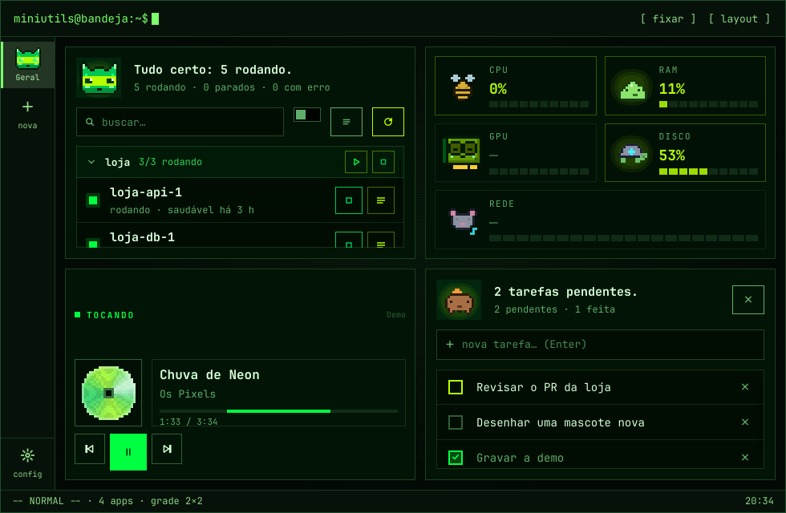
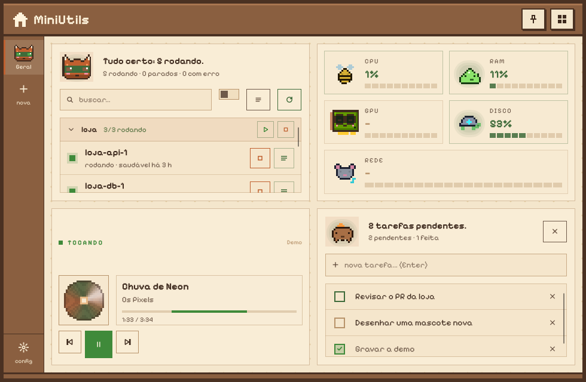
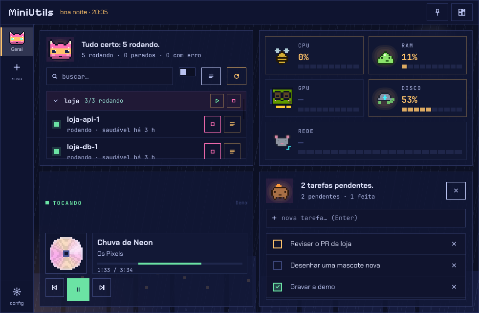
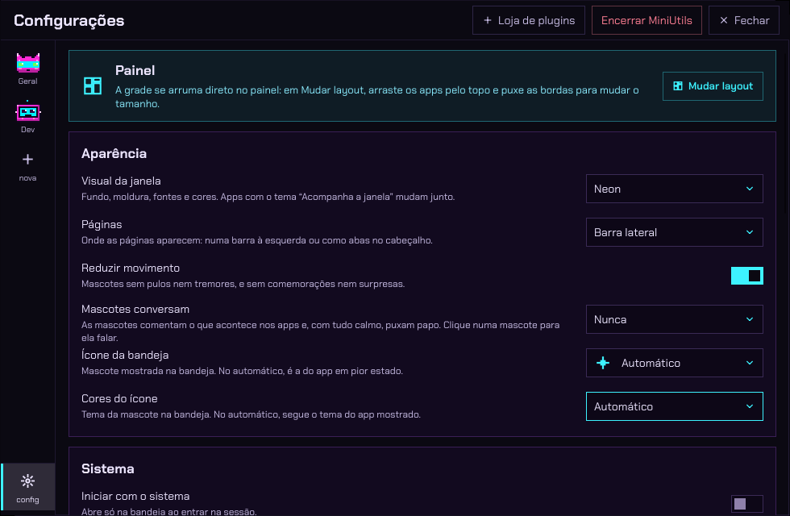
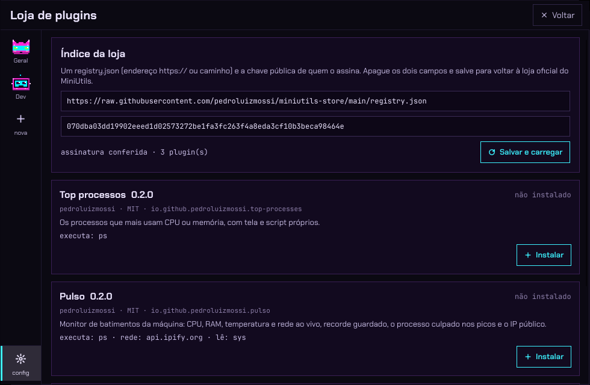

<div align="center">

# MiniUtils

**Um hub de mini-apps que mora na bandeja do sistema, com mascotes em pixel art que reagem ao que está acontecendo.**

[](https://github.com/pedroluizmossi/hub-app-rust/actions/workflows/ci.yml)
[](https://github.com/pedroluizmossi/hub-app-rust/releases)


[](LICENSE)



[Instalar](#instalar) · [Mini-apps](#mini-apps-incluídos) · [Visuais](#um-visual-para-cada-humor) · [Criar apps](#loja-e-criação-de-apps) · [Desenvolver](#desenvolvimento)

</div>

---

Clique na mascote da bandeja e o hub abre como popup junto do ícone; clique fora ou aperte
Esc e ele some. Lá dentro ficam pequenos apps (Docker, sinais vitais, música, tarefas…) que
você liga, desliga e arruma numa grade. Cada um tem uma mascote que dorme quando está tudo
calmo, fica agitada sob carga e entra em alarme quando algo dá errado. A bandeja mostra
sempre a mascote do app em pior estado, então dá para saber que um container caiu sem abrir
nada.

O MiniUtils é a reescrita do plasmoid CyberDock em **Rust + Slint**, sem depender do KDE.

- **Leve:** um único binário, ~25 MB na bandeja e ~30 MB com a janela aberta. App desligado
  não desenha, não tem timer e não coleta dado.
- **Nativo no Linux e no Windows:** KDE, XFCE, Cinnamon, MATE e GNOME (com a extensão
  AppIndicator); Windows 10 e 11.
- **Extensível:** plugins e apps da comunidade se instalam pela loja, sem recompilar o hub.
- **Seguro por padrão:** um plugin só roda os programas que declara, sem shell. Acesso total
  é declarado e aparece em destaque antes de instalar.

## Mini-apps incluídos

| App | O que faz | Começa |
|---|---|---|
| **Docker** | Containers e stacks com ações rápidas: iniciar, parar, reiniciar, logs e shell. Notifica quando algo cai, entra em loop ou fica *unhealthy*. | ligado |
| **Sinais vitais** | CPU, RAM, GPU (NVIDIA ou AMD), disco e rede, cada um com a própria mascote, histórico do último minuto e temperatura. | ligado |
| **CD Player** | O que está tocando (MPRIS no Linux, controles de mídia no Windows): disco em pixel art girando, faixa, progresso e controles. Pode pôr a música no menu da bandeja. | ligado |
| **Assinaturas de IA** | Janelas de uso do Codex, Claude Code e OpenCode Go e créditos do Kiro, com previsão de quando o limite acaba. [Detalhes](#assinaturas-de-ia) | desligado |
| **Portas abertas** | Quem escuta em cada porta, se é só local ou aberta para a rede, atalho para abrir no navegador e botão de encerrar (dois cliques). | desligado |
| **To-do rápido** | Lista curta de tarefas: Enter acrescenta, clique marca como feita, e a mascote comemora quando a lista zera. | desligado |
| **Agentes de IA** | Sessões do Claude Code, Codex e OpenCode: quem trabalha (e em quê), quem espera por você e quem terminou, com os subagentes. Abre a pasta, um terminal ou retoma a sessão. | desligado |

Os apps desligados se ligam em **Configurações › Apps**.

<p align="center">
  
</p>

<details>
<summary><b>Mais sobre o app Agentes de IA</b></summary>

Cada sessão é um cartão com o que a ferramenta informa (no Claude: modelo, esforço, branch,
tokens, duração do último turno, último pedido e os subagentes), e a última ferramenta usada
aparece sem o comando inteiro. Clicar no cartão mostra as opções: abrir a pasta do projeto,
abrir um terminal nela e, numa sessão parada do Codex ou do OpenCode, retomar a sessão. O app
só lê o que as ferramentas já gravam no disco, sem mexer na configuração delas, e pode
notificar quando um agente termina ou espera por você.

</details>

## Mascotes que têm humor



Todo app tem uma mascote, e cada mascote tem cinco humores:
`sleep` < `idle` < `happy` < `busy` < `alarm`.

O app decide o humor pelo próprio estado (o Docker dorme sem containers e entra em alarme
quando algo cai) e a bandeja mostra o pior de todos. As mascotes também **conversam**: cada
app conta fatos sobre si (um problema, uma previsão, uma recuperação) e o hub decide quem
fala e quando. Clique numa mascote para ela falar.

São mais de trinta mascotes, de neko e capivara a chaleira e cogumelo, e cada app escolhe a
sua em Configurações. Para ver uma animação: `miniutils --previa <mascote>`.

<br clear="right">

## Um visual para cada humor

O visual da janela muda tudo de uma vez: moldura, fundo, fontes e as cores dos apps. Escolha em
**Configurações › Aparência**.

<table>
  <tr>
    <td align="center"><br><b>Neon</b>: cyberpunk, cantos cortados</td>
    <td align="center"><br><b>Terminal</b>: fósforo verde e prompt</td>
  </tr>
  <tr>
    <td align="center"><br><b>Aconchego</b>: casinha de madeira, tema claro</td>
    <td align="center"><br><b>Noite chuvosa</b>: lua, prédios e chuva</td>
  </tr>
</table>

Cada visual é uma tabela de valores em `src/skin/mod.rs`, com um fundo desenhado em
`src/skin/backdrop.rs`. Apps com o tema "Acompanha a janela" mudam junto; quem quiser fixa um
tema por app. Como criar um visual novo: [DESIGN.md](DESIGN.md).

## Instalar

Uma linha instala (ou atualiza) a última versão de
[Releases](https://github.com/pedroluizmossi/hub-app-rust/releases), só para o seu usuário e
sem senha de administrador. O script confere a soma SHA-256 do pacote antes de instalar.

**Linux** (x86_64, glibc 2.35+: Ubuntu 22.04+, Fedora 36+, Debian 12+, Arch…)

```bash
curl -fsSL https://raw.githubusercontent.com/pedroluizmossi/hub-app-rust/master/install.sh | sh
```

Instala em `~/.local/bin/miniutils`, com atalho no menu de aplicativos.

**Windows 10 ou 11** (PowerShell)

```powershell
irm https://raw.githubusercontent.com/pedroluizmossi/hub-app-rust/master/install.ps1 | iex
```

Instala em `%LOCALAPPDATA%\Programs\MiniUtils`, com atalho no Menu Iniciar. Se o MiniUtils
estiver aberto, ele é fechado para a troca e aberto de novo na bandeja.

> [!NOTE]
> O executável do Windows não é assinado. Baixado pelo navegador, o Windows pode mostrar o
> aviso do SmartScreen: clique em **Mais informações › Executar assim mesmo**.

Também dá para baixar o `.tar.gz` ou o `.zip` do Release e rodar o `miniutils` de dentro da
pasta.

<details>
<summary><b>Desinstalar</b> (a configuração é mantida)</summary>

```bash
# Linux
curl -fsSL https://raw.githubusercontent.com/pedroluizmossi/hub-app-rust/master/install.sh | sh -s -- --uninstall
```

```powershell
# Windows
& ([scriptblock]::Create((irm https://raw.githubusercontent.com/pedroluizmossi/hub-app-rust/master/install.ps1))) -Uninstall
```

</details>

<details>
<summary><b>Requisitos</b> do que cada app usa</summary>

**Linux**

- Uma bandeja do sistema (StatusNotifierItem): KDE, XFCE, Cinnamon e MATE já têm. No GNOME,
  instale a extensão *AppIndicator*. Sem bandeja, o hub continua funcionando como janela.
- Docker acessível sem `sudo` (usuário no grupo `docker`).
- Um player MPRIS para o CD Player (Firefox, Chromium, VLC, mpv, Spotify…). Sem player, o app
  mostra "sem disco".
- `nvidia-smi` para GPUs NVIDIA. Placas AMD são lidas direto do driver `amdgpu`.
- Um terminal para os botões de logs e shell: usa `$TERMINAL` ou detecta konsole,
  gnome-terminal, kgx, xfce4-terminal, alacritty, kitty, foot e outros.
- Portas abertas usa o `ss`; sem root, só aparecem os processos do seu usuário.

**Windows** (o mesmo código, com o equivalente nativo de cada parte)

- Ícone na área de notificação: clique abre o popup, clique direito abre o menu.
- Docker Desktop para o app Docker (`docker` no PATH).
- CD Player pelos controles de mídia do sistema, o que aparece no painel de volume.
- `nvidia-smi` para GPUs NVIDIA. Placas AMD e Intel ainda não são lidas no Windows.
- Sinais vitais sem carga média e sem temperatura da CPU (o Windows não as entrega sem driver
  ou privilégio).
- Portas abertas pelo `netstat`; "encerrar" fecha o processo na hora.
- Logs e shell abrem no Windows Terminal (`wt`) ou, sem ele, no console clássico.

</details>

## Usar no dia a dia



- **Abrir:** clique na mascote da bandeja. O popup some ao clicar fora ou com Esc; o alfinete
  o mantém aberto.
- **Arrumar a grade:** o botão de layout (ícone de grade) liga o modo de edição. Arraste cada
  app pelo topo e puxe as bordas para mudar o tamanho; as setas movem e Shift + setas
  redimensiona.
- **Páginas:** separe os apps em páginas (Geral, Dev…), na barra lateral ou em abas.
- **Configurar:** a engrenagem abre as Configurações: aparência, sistema, páginas e as opções de
  cada app.
- **Iniciar com o sistema:** **Configurações › Sistema › Iniciar com o sistema** abre só na
  bandeja ao entrar na sessão.
- **Atalho de teclado:** com o MiniUtils aberto, `miniutils --tab <nome>` traz a janela naquela
  página (pelo nome dela ou de um app nela, ex. `Geral`, `docker`), em `apps` ou em `store`.
  Ligue esse comando a um atalho do sistema.

<br clear="right">

<details>
<summary><b>Linha de comando e variáveis de ambiente</b></summary>

```text
--hidden              inicia só na bandeja (para o autostart)
--tab <nome>          abre numa página do painel (pelo nome dela ou de um app nela,
                      ex.: Geral, docker), em apps (configurações) ou em store (loja)
--plugin-dev <pasta>  carrega o plugin da pasta e recarrega ao salvar (ver APPS.md)
--previa <mascote> [animação] [--saida arquivo.gif]
                      GIF de uma animação de mascote em todos os temas
--version             mostra a versão (também em Configurações › Sistema)
```

`miniutils --help` mostra também os comandos da loja de plugins.

```text
MINIUTILS_NATIVE_WAYLAND=1   usa Wayland nativo em vez de XWayland (o popup perde a posição)
MINIUTILS_DEBUG=1            registra também os detalhes (foco, janela, debug() dos plugins)
```

</details>

<details>
<summary><b>Configuração e registros (logs)</b></summary>

A configuração fica em `~/.config/miniutils/config.toml` (na primeira execução, a de
`~/.config/cyberhub/` é copiada para lá). A linha `name = "MiniUtils"` muda o nome exibido na
janela, na bandeja e nas notificações.

Avisos, erros e travamentos vão para um arquivo, além do terminal:

- Linux: `~/.local/state/miniutils/miniutils.log`
- Windows: `%LOCALAPPDATA%\miniutils\logs\miniutils.log`

O botão **Abrir registros** em Configurações › Sistema abre a pasta. Ao relatar um problema,
mande esse arquivo e a versão. Passando de 1 MiB, o arquivo vira `miniutils.1.log` e um novo
começa. `MINIUTILS_DEBUG=1` registra também os detalhes.

</details>

## Assinaturas de IA

O app consulta diretamente os serviços usando os logins locais dos clientes oficiais, e só
enquanto está ligado: Claude, Codex e OpenCode a cada três minutos, Kiro a cada quinze.
**Atualizar** antecipa as leituras, respeitando a pausa após um HTTP 429. Nenhuma conversa é
lida ou salva.

Quando o ritmo da última hora indica que um limite acaba antes de renovar, a janela mostra a
previsão ("Acaba ~16:10 · renova 18:00"). Se o ritmo dos últimos vinte minutos aponta o
mesmo, a mascote fica agitada mesmo abaixo do percentual configurado e avisa as outras.

> [!IMPORTANT]
> Os endpoints de Claude, Codex e Kiro não são públicos e podem mudar.
>
> O Claude usa o login OAuth de `~/.claude/.credentials.json` (ou `CLAUDE_CONFIG_DIR`). Se o
> token estiver vencendo, o MiniUtils tenta renová-lo e grava o resultado no mesmo arquivo,
> preservando os demais campos. Isso compartilha credenciais com o Claude Code: se os dois
> renovarem ao mesmo tempo, pode ser preciso entrar de novo no Claude. Não imprima nem
> compartilhe esse arquivo.

<details>
<summary><b>Detalhes de cada serviço</b></summary>

- **Claude:** o uso direto não exige uma sessão ativa do Claude Code.
- **Codex, Kiro e OpenCode:** o MiniUtils lê as credenciais existentes sem renová-las. Quando
  expirarem, atualize o login no cliente correspondente; o cartão informa a falha.
- **Kiro:** a variável `KIRO_API_KEY` tem prioridade sobre o login OAuth no banco do Kiro e
  precisa estar no ambiente em que o MiniUtils é iniciado. O cartão mostra os créditos
  incluídos, sem somar créditos adicionais.
- **Falhas:** numa falha de conexão, o último valor é marcado como antigo; numa falha de
  autenticação, a leitura anterior é removida.
- **Previsão:** precisa de quinze minutos de leituras, só vale para janelas com horário de
  renovação e pode ser desligada nas opções do app. Ao lado do percentual, uma linha fina
  mostra o uso da última hora. No modo compacto, o texto e a linha não aparecem.

</details>

## Loja e criação de apps



Plugins e apps da comunidade se instalam pela
[loja](https://github.com/pedroluizmossi/miniutils-store), sem recompilar o hub. O índice é
assinado, cada plugin aponta para um commit revisado, e antes de instalar o hub mostra o que
o plugin vai executar, os domínios que acessa e os dados que lê.

Há quatro jeitos de estender o hub; comece pelo mais simples que resolve:

| Tipo | A lógica é | Chega por |
|---|---|---|
| **Plugin simples** | a saída de um comando, só com manifesto | loja |
| **Plugin com tela** | uma tela própria e um script Rhai isolado | loja |
| **App externo** | um executável seu, em qualquer linguagem, com acesso total | loja, com SHA-256 conferido |
| **Mini-app embutido** | Rust compilado dentro do hub | pull request |

O guia completo, com o que cada tipo pode fazer e um exemplo de cada, está em
[APPS.md](APPS.md). Apps externos e o SDK `miniutils-app` ficam no
[miniutils-apps](https://github.com/pedroluizmossi/miniutils-apps).

<br clear="right">

## Desenvolvimento

Precisa de Rust (via [rustup](https://rustup.rs)).

```bash
cargo build --release
./target/release/miniutils
```

No Windows, o mesmo comando gera `target\release\miniutils.exe`. Para rodar os testes:

```bash
cargo test
```

| Documento | O que tem |
|---|---|
| [ARCHITECTURE.md](ARCHITECTURE.md) | Princípios, visão geral, estrutura de pastas e roteiro |
| [DESIGN.md](DESIGN.md) | Como criar visuais, temas, telas, mini-apps e mascotes |
| [APPS.md](APPS.md) | Os quatro tipos de app, manifesto, provedores e exemplos |
| [AGENTS.md](AGENTS.md) | Regras para agentes de código: compilar, validar e ver a interface |

<details>
<summary><b>CI e lançamentos</b></summary>

- **CI** (`.github/workflows/ci.yml`): todo push em `master` e todo pull request roda
  `cargo check`, `cargo clippy` (aviso reprova) e `cargo test` em Ubuntu e Windows.
- **Lançamento** (`.github/workflows/release.yml`): uma tag `vX.Y.Z` igual à `version` do
  `Cargo.toml` compila a versão final nos dois sistemas e publica um Release com
  `miniutils-<versão>-linux-x86_64.tar.gz`, `miniutils-<versão>-windows-x86_64.zip` e as somas
  SHA-256. Os testes não rodam nele: crie a tag num commit que passou no CI. O `install.sh` e o
  `install.ps1` dependem desses nomes de arquivo; mudou um, mude os dois.

  ```bash
  git tag v0.3.0 && git push origin v0.3.0
  ```

  Tag com hífen (`v0.3.0-rc1`) sai como pré-lançamento. Rodar o workflow à mão (aba Actions)
  só gera os pacotes como artefatos, sem publicar.

</details>

## Licença

MIT. A interface usa o [Slint](https://slint.dev) sob a Royalty-free Desktop License. As
fontes embutidas (Chakra Petch, JetBrains Mono e Pixelify Sans, em `ui/fonts/`) são
distribuídas sob a SIL Open Font License; as licenças estão na mesma pasta.

<sub>As capturas usam dados de demonstração.</sub>
